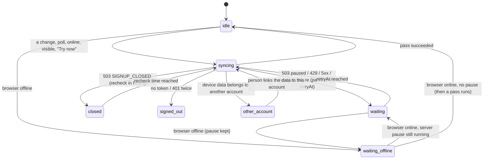
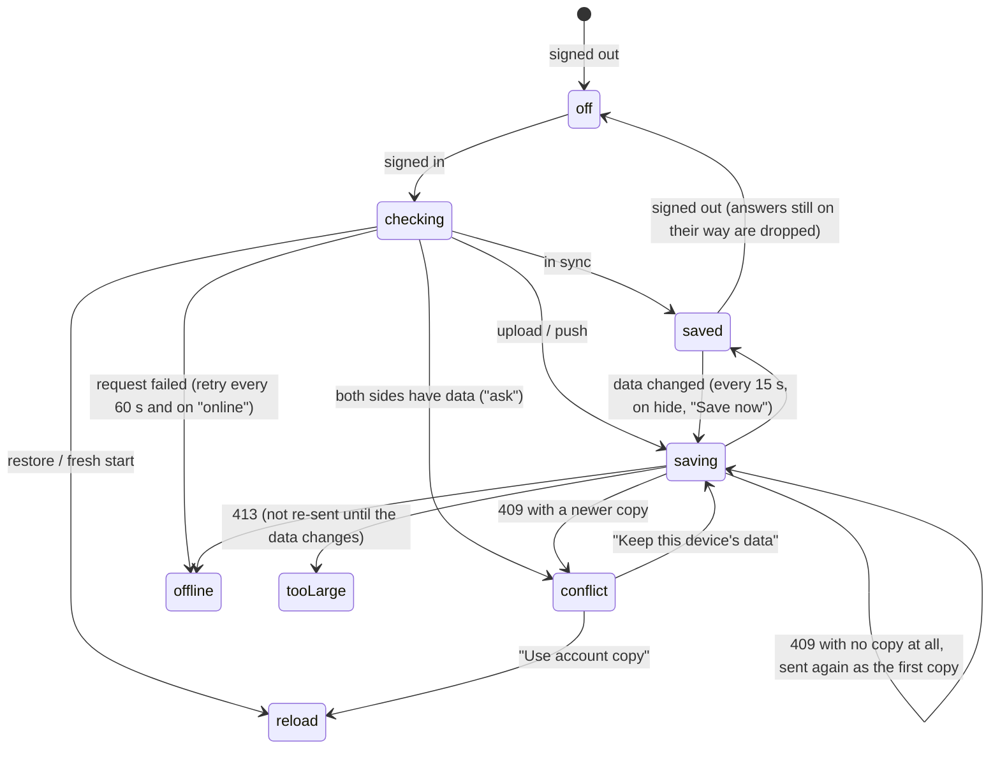
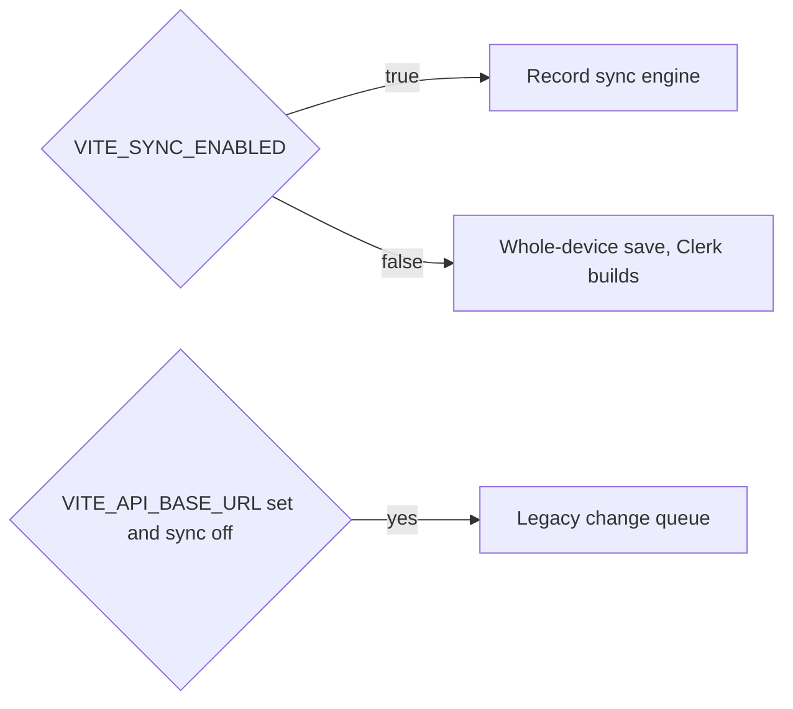
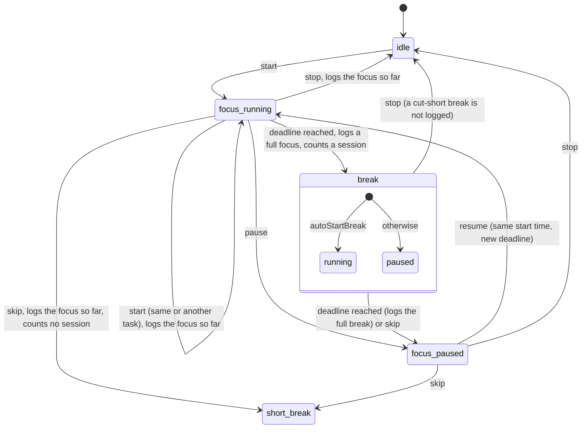
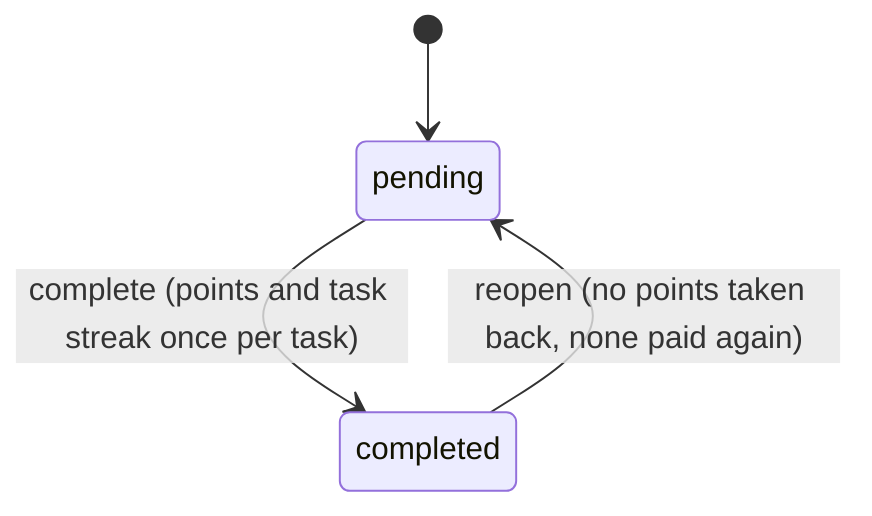
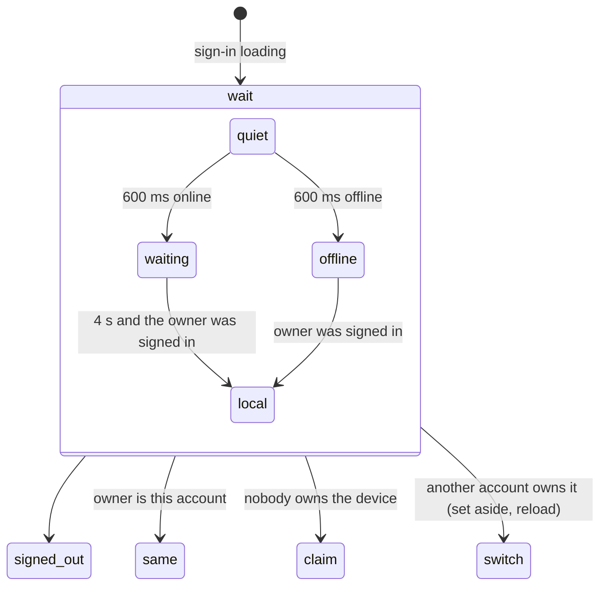

# Implicit state machines in Gylio

> Round SM-1 (2026-11-11). Every place where the app moves between named states without an explicit machine, what the
> states and transitions are, what was wrong with them, and what changed. Diagrams are Mermaid (GitHub renders them).
> Findings are logged in [wiki/INDEX.md](wiki/INDEX.md) (SM-1 … SM-9) and the steps in [wiki/LEDGER.md](wiki/LEDGER.md).

How the inventory was made: searched the code for status, phase, step and mode unions, `setStatus`/`setStep`/`setPhase`
calls, boolean pairs that together mean a state (`active` + `completed`), and timers, then read each owner and every
caller. A state machine counts here when the person can see its state or when two parts of the app depend on it.

| # | Machine | Owner | States | Verdict |
|---|---|---|---|---|
| 1 | Record sync engine | `src/core/sync/engine.ts` | idle, syncing, waiting(offline / paused / rate-limited / server-error), closed, signed-out, other-account | **Fixed** (SM-1) |
| 2 | Whole-device account save | `src/features/account/AccountSyncContext.tsx` | off, checking, saving, saved, offline, conflict, tooLarge | **Fixed** (SM-5, SM-6, SM-7) |
| 3 | Which sync runs | `flag.ts`, `WholeDeviceSaving.tsx`, `backgroundSync.ts` | record sync / whole-device save / legacy queue | Documented, see "Open" |
| 4 | Legacy change queue | `src/core/utils/offlineSync.ts`, `backgroundSync.ts` | pending, retry, conflict | No change |
| 5 | Focus timer (Pomodoro) | `src/core/context/timerMachine.ts` (new) | idle, focus·running, focus·paused, break·running, break·paused | **Rebuilt** (SM-2, SM-3, SM-4) |
| 6 | Time tracker run | `src/features/timetracking/TimeTrackerContext.tsx` | none, running(ok / away / over), stopped-with-undo | **Fixed** (SM-8) |
| 7 | Task status and rewards | `src/features/tasks/hooks/useTasks.ts` | pending, completed (+ points, streaks) | **Fixed** (SM-9) |
| 8 | Account data gate | `src/core/account/accountGate.ts` | wait, signed-out, same, claim, switch + quiet / waiting / offline / local | No defect found |
| 9 | Sign-out | `src/features/account/SignOutSection.tsx` | idle, confirm, busy, failed | No defect found |
| 10 | Onboarding | `src/hooks/useOnboardingFlow.jsx` | step 0..2, complete; hydrated | Redundant writes, harmless |
| 11 | Guided tour | `src/core/context/GuidedTourContext.tsx` | inactive, selector, active(step n), completed | Unused action noted |
| 12 | Entitlement (Pro) | `src/features/billing/EntitlementContext.tsx` | none, cached, live; loading; error | Late answer noted |
| 13 | Gamification switch | `src/core/hooks/useGamification.ts` | on (default), off after hydration | Race noted |
| 14 | Daily mode, calendar view, theme, motion | small hooks | two or three values each | Trivial, no defect |

---

## 1. Record sync engine

**SM-1 (fixed): a network blip erased a pause the server asked for, and hid states that need the person.**
`setOnline(false)` wrote "waiting/offline" over *any* state except syncing; `setOnline(true)` then cleared the pause
whenever the shown state was "waiting/offline". So 429 or `SYNC_PAUSED` with `Retry-After: 1800`, then the Wi-Fi
dropping for a second, sent the next request at once: the client broke the server's back-off, the very contract that
protects a usage-limited backend. The same overwrite hid **closed** and **other-account** (the one state that asks
the person to choose) for as long as the device was offline.
*Root cause:* the shown state was used as the record of *why* the engine was paused; `pauseReason` already held that.
*Fix:* coming back online clears only a pause whose reason is the network; going offline replaces only idle or
waiting, and the held state is shown again when the network returns. Tests: `engine.test.ts`, "the network drops
while sync is already held back for another reason" (3 of 4 failed before the fix).

## 2. Whole-device account save

**SM-5 (fixed): two saves from the same version made the second a conflict with the device's own data.** Only the
15-second save took the `busy` lock; "Save now", the first sync's upload and the conflict choice did not. A press of
"Save now" while the background save was on its way sent a second PUT with the same `baseVersion`; the server took
one and refused the other with 409, and the person was asked to choose between two copies of their own data.
*Fix:* one `exclusive()` lock for every path; "Save now" waits for the conflict choice.

**SM-6 (fixed): a state with nothing behind it.** A 409 with `state: null` (the account copy is gone, e.g. the
server fell back from MongoDB to SQLite, or the row was reset) set status `conflict` with `conflict = null`: the
banner hides itself (no copy to describe), and the save loop, gated on `conflict`, retried every 15 seconds for ever.
*Fix:* the device copy is sent again from version 0 as the account's first copy.

**SM-7 (fixed): answers for a person who has signed out.** A first sync or save still on its way when the person
signed out (or switched) could set `saving`/`conflict`, open the conflict banner on the sign-in screen, or restore and
reload another person's copy. *Fix:* every continuation checks it is still for the same person; signing out also
clears a pending conflict.

## 3. Which sync runs (documented)

The record engine and the whole-device save never run together (`WholeDeviceSaving`). The legacy queue and the
whole-device save *can* run together in a Clerk build with `VITE_API_BASE_URL`: they write different data to
different routes of the same Express server, so they do not collide, but the account then holds the tasks twice in
two shapes. Left as is: retiring the legacy queue is a product decision about the Express deploy, not a defect.

## 4. Focus timer (rebuilt)

All rules live in one pure reducer (`timerMachine.ts`); the provider only feeds it the clock and saves what it logs.

**SM-2 (fixed): a hidden tab stretched the block.** The countdown subtracted 1 per `setInterval` tick. Chrome wakes
timers of a hidden tab about once a minute after five minutes ("intensive wake-up throttling", Chrome 88+), so a
25-minute block left in a background tab ran for far longer, and its log said 25 minutes. *Fix:* the phase ends at a
wall-clock deadline (`endsAt`); ticks only refresh the display, and one late tick finishes every phase that is due,
each from the moment the previous one ended. Also catches up after the page was closed.

**SM-3 (fixed): finished time lost.** Logged stretches sat in one slot that only the Tasks screen saved. A block that
ended while the person was on another screen was overwritten by the break after it; a failed save (the database still
opening) cleared the entry anyway; side effects ran inside state updaters, which React StrictMode calls twice; a reload
lost the running block. *Fix:* entries queue in the machine and the provider saves them oldest first, keeps an entry
until it is saved, retries a failed save, never starts the same save twice; the machine is kept on this device
(`gylio:focusTimer:v1`, device-only) and survives a reload; other tabs follow it (`storage` event), and appending a
log entry skips one already there, so two tabs that both see a block end add it once.

**SM-4 (fixed): contradictory counts.** Skipping a focus block counted it as a finished session (and could earn the
long break), while its log entry said `completed: false`, so "Session 4" disagreed with the task card's completed
sessions. Resuming moved `phaseStartedAt`; switching task from a paused block dropped the time worked; settings of 0
made a phase end at once or the long break never come. *Fix:* only a full block counts (the Pomodoro Technique's own
rule: an interrupted pomodoro does not count); resume keeps the start; every way of leaving a focus block logs it;
settings are clamped to whole numbers in sane bounds. The clock is `role="timer"` instead of a live region that a
screen reader read out every second; the phase label is the live part.

## 5. Time tracker and focus timer together

**SM-8 (fixed): the same minutes counted twice.** Starting the tracker stopped the focus timer, but starting the focus
timer left the tracker running. Worked time is focus + tracked, so the overlap counted twice and skewed the estimate
calibration built on it. *Fix:* starting the focus timer saves and stops the tracker run.

## 6. Task status and rewards

**SM-9 (fixed), three parts.**
- *A loop that paid:* every pending → completed edge paid 10 points, so complete / reopen / complete paid again, and
  a step ticked on and off paid 5 each time. *Fix:* `core/utils/rewardLedger.ts` pays each task and step once; it is
  stored with the app data, so it follows the person to another device. Non-punitive: reopening takes nothing away.
- *An unreachable state:* the daily focus streak (with its skip tokens) was written only by `useTasks().startPomodoro`,
  which nothing calls, so "Daily focus streak" on the Rewards screen could never grow. *Fix:* the focus timer pays 10
  points and the focus streak when a full block is saved (only the tab whose save added it); the dead timer and its
  notification code are removed.
- *A toggle on a stale copy:* Daily Mode showed its own fresh list but completed through another list's cached
  status, which could flip a task it meant to complete back to pending. *Fix:* it says `'completed'`.

## 7. Account data gate and sign-in wait (no defect found)

Checked: every `GateStep` has an outcome, a refused switch keeps the data hidden (`no-room`), and the wait never opens
data after a sign-out. Tests already cover each line (`accountGate.test.ts`).

## 8. Sign-out (no defect found)

`idle → confirm → busy → (page leaves) | failed`; "keep data" goes `idle → busy` directly. Buttons are disabled while
busy, failure leaves both paths available, the confirm panel stays open after a failed removal.

## 9. Onboarding, tour, entitlement, gamification (noted, not changed)

- **Onboarding:** each action writes the state in its updater *and* the effect writes it again. Same value, so no
  wrong state; a redundant write per step. Left alone: changing it touches the first-run path for no visible gain.
- **Tour:** `startTour()` is exported but unused; on a completed tour it would reopen at the last step with
  `active && completed`. Nothing calls it, so no person can reach that state today.
- **Entitlement:** a `refresh()` answer that arrives after sign-out can set the entitlement while `userId` is null;
  `resolvePlan` returns free without a user, and an account switch reloads the page, so no wrong plan is shown.
- **Gamification switch:** reads its saved value asynchronously and starts as *on*, so points earned in the first
  moment after load are paid even if the person turned gamification off. Small window; worth fixing when the setting
  moves into the shared settings store.

## Red team

Four adversarial reviews of every change, each by a reviewer that had not seen the reasoning above, each followed by
fixes and tests before the next one.

**Round 1** found, and this round fixed:
- *Tracker saved twice across tabs.* The tracker run is per tab; once the focus timer followed other tabs, starting
  it in tab B made tab A stop its own copy of the tracker run too, with a different end time, which the
  start-and-end duplicate check did not catch. One start is now one stretch: the check matches kind + start time.
- *Credit lost when the browser discards a tab.* Chrome's Memory Saver reloads a discarded tab, which the closed-page
  rule (`wake`) read as "closed at the last tick". `document.wasDiscarded` now counts as open all along, like a tab
  that was only hidden.
- *A press after the deadline, before the next tick.* Stop, skip and pause did not finish a phase whose deadline had
  passed, so a full block was logged as interrupted (no points, no session), and skip could skip the break it had
  already reached. Each now finishes due phases first.
- *Account save:* "Save now", the first upload and the conflict choice now wait their turn for the lock instead of
  being dropped while a background save runs, and read the version once it is their turn; a failed request for the
  previous person no longer sets the new person's status.
- *Timer settings* now reach every open tab, so two tabs cannot start different phases at the same deadline.

Accepted after round 1: a page killed by the operating system (not discarded) and reopened later counts as closed;
a reload in the instant between the database write and the queue update loses that block's points (the time is
kept); two steps with the same text in one task pay once, and renaming a done step pays again.

## Trade-offs taken

- **Persisting the focus timer** adds cross-tab and reload states that did not exist. Covered by tests (reload,
  pause in another tab, same entry from two tabs) and by idempotent saving. A crash in the instant between the
  database write and the queue update could still save an entry twice on the next load: at-least-once was chosen
  over at-most-once because losing focus time is worse than a duplicate the person can delete.
- **Skipped focus no longer counts toward the long break.** Someone who skips blocks often will see the long break
  later than before. This follows the Pomodoro Technique; if people expect the old behaviour, a setting is cheap.
- **A cut-short break is not logged.** Breaks never counted toward worked time; logging partial ones only added rows.
- **Points are paid once per task, keyed by id, and per step by its text.** Renaming a step makes it payable again;
  reopening never takes points back. Chosen to stay non-punitive.
- **A missing account copy is re-uploaded.** If a future feature deletes account data on purpose, it must also clear
  each device's saved version, or the device will bring the data back.
